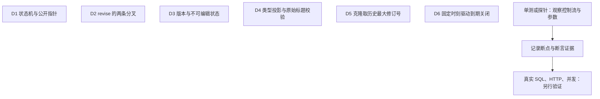

# VH02 调试学习包：内容生命周期与双修订

本版按“测试驱动 → 断点 → 单步 → 观察 → 实验 → 证据”完成学习。源码基准 HEAD `0bd9677`，原有学习注释和 BootstrapAdminCommandTest 改动保留。

| 顺序 | 文件 | 用途 |
|---|---|---|
| 1 | [01-debug-walkthrough.md](01-debug-walkthrough.md) | 每站夹具、精确测试方法与断点 |
| 2 | [03-step-runbook.md](03-step-runbook.md) | 逐站照着操作 |
| 3 | [04-observation-sheets.md](04-observation-sheets.md) | 先预测再填实际 |
| 4 | [05-probe-test.md](05-probe-test.md) | 探针安装与清理 |
| 5 | [06-experiments.md](06-experiments.md) | 三个可复现实验及恢复 |
| 6 | [07-question-sheet.md](07-question-sheet.md) | 闭卷题与参考答案 |
| 7 | [08-evidence-ledger.md](08-evidence-ledger.md) | 实测/未测及学习者台账 |
| 8 | [09-verified-annotations.md](09-verified-annotations.md) | 验证后才采用的注释 |

## 环境与第一次启动

1. IDEA 打开 `D:\学习资料\voidhaven-platform\apps\api`，Project SDK、Maven Runner JRE 都选 JDK 17；重新加载 Maven。
2. 先运行本页基线命令。离线缺依赖时记录缺失依赖，不把下载失败当成业务失败。
3. 在测试方法旁选择 **Debug**（不是 Run），断点先放在方法中的第一条可执行语句和最后的断言行。
4. Windows 默认键位：F8 越过、F7 进入、Shift+F8 跳出、F9 到下一断点、Alt+F8 求值。仅启用当前站断点。
5. 方法声明是定位锚点；若该行无可执行字节码，将断点放到其方法体第一条语句。源码行号随学习注释变化时，以锚点文本为准。
6. Variables/Watches 必须选对 Frames 中的栈帧；局部变量仅在执行赋值后可见。不要在 Watches 调用 `publish/consume/delete` 等有副作用方法。

**排错**：灰色断点先 Run 编译；不命中先确认 Debug 的具体方法与分支输入；停进 Mockito 用 Shift+F8 返回；捕获 SQL 必须先执行 `verify(...capture())`；预期异常需开启 caught 异常断点。`BUILD SUCCESS` 只说明测试结果，不能代填“断点已停住”。

## 运行基线

先按 [探针说明](05-probe-test.md) 安装本层探针，然后运行：

```powershell
Set-Location 'D:\学习资料\voidhaven-platform\apps\api'
$env:JAVA_HOME = 'D:\JDK\JDK17'
$mvn = 'D:\Maven\apache-maven-3.9.4\bin\mvn.cmd'
& $mvn -o "-Dtest=ContentItemStateTest,ContentManagementServiceTest,ContentRevisionCandidateServiceTest,ContentLifecycleServiceTest,ContentActionServiceTest,ContentManagementServiceReviseProbeTest" test
```

## 站点与完成条件

- D1：状态机与公开指针
- D2：revise 的两条分叉
- D3：版本与不可编辑状态
- D4：类型投影与原始标题校验
- D5：克隆取历史最大修订号
- D6：固定时刻驱动到期关闭

每站至少一次真实暂停，填写全部观察行；完成三个预测实验并恢复修改；能解释真实对象和替身的边界。单测完成与真实栈完成分开记录，环境阻塞允许登记但不能计为通过。

## 图示

下图表达测试证据范围，不代表一次 HTTP 请求全部穿过这些单测。旧 PNG 属于首版概览，未作为本版验收证据；以本版 Mermaid 和脚本为准。



## 真实环境门槛

见 [统一环境与证据边界](../10-real-stack-boundary.md)。原 PNG 保留作首版概览，本版以 Mermaid 和脚本为准。
